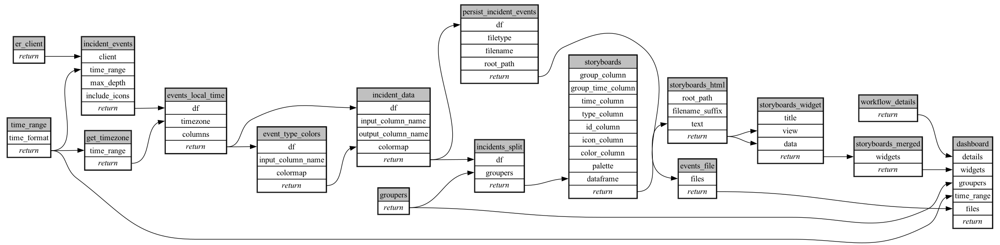

```
# AUTOGENERATED BY ECOSCOPE-WORKFLOWS; see fingerprint in README.md for details

```

```yaml
# fingerprint:
artifacts_sha256_basic: d78bf7b634c67f8c2db83bb7895a2c6bb54057f242947ca2c7880ba45b8043a4
artifacts_sha256_strict: 06a593e0afb8cf54ff84feda4f6b655c423bf8ac46742dc9224a24a89411dd37
installed_requirements:
- channel: https://repo.prefix.dev/ecoscope-workflows/
  name: ecoscope-platform
  version: {version: ==2.39.3}
- channel: conda-forge
  name: pydeck
  version: {version: ==0.9.2}
params_sha256: 3a9d4c0650b90c4d20fdafff1b81f6d11bb43e5f182dea9cdd40c6c119521542
spec_sha256: 870640714086cc92dc29054d636a79a9d6d89033408c09eec632eed8bfca6298

```

# ecoscope-workflows-incident-storyboard-workflow


